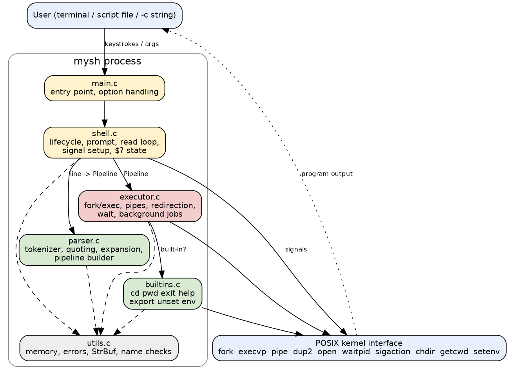
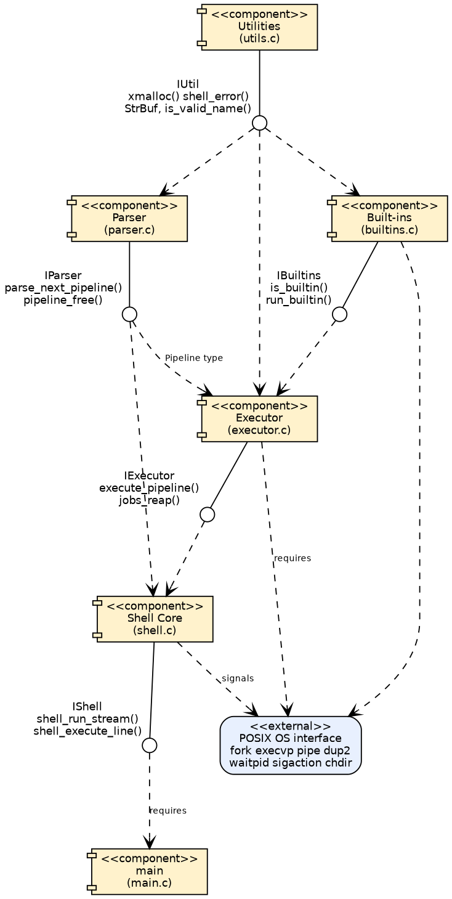
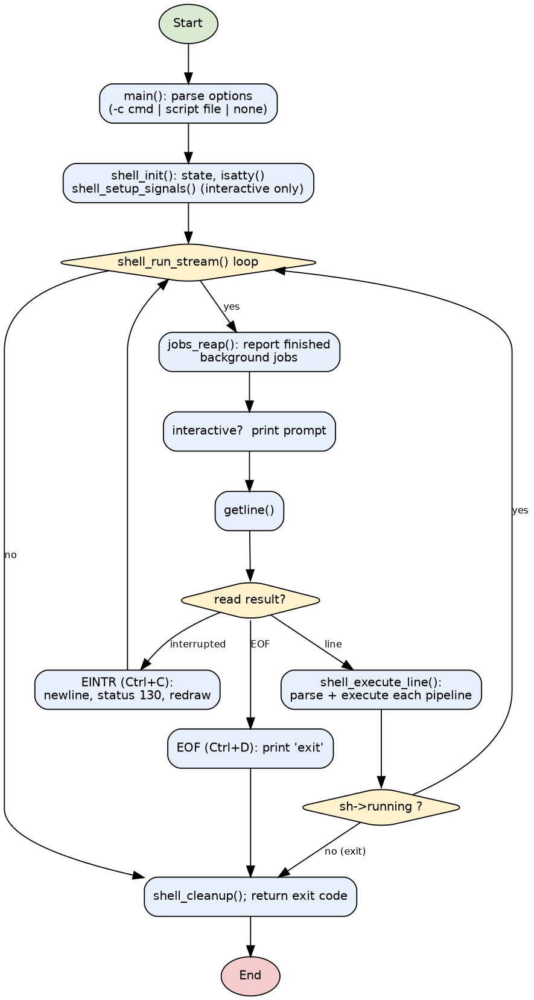
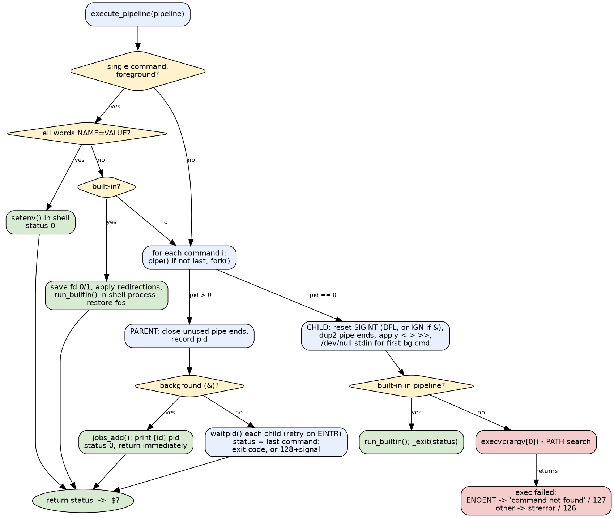
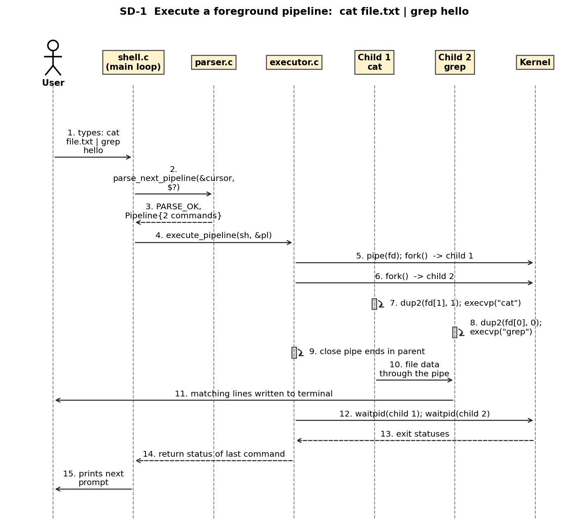

# Abstract

This report describes the requirements, design, implementation and verification of *mysh*, a simple Unix-like command-line shell written in C. The shell reads commands interactively or from files, executes external programs using `fork()` and `execvp()`, provides built-in commands (cd, pwd, exit, help, export, unset, env), supports environment variables, quoting, input/output redirection, pipelines, command sequencing, background execution and Ctrl+C handling. The work follows a software-engineering process: a Software Requirements Specification with 22 functional and 9 non-functional requirements, a modular architecture, a requirement traceability matrix and a layered test strategy. 130 tests were designed and executed on Ubuntu 24.04; 130 passed and 0 failed.

# 1. Introduction

The shell is the classic interface to a Unix-like operating system. Building one exposes the central operating-system mechanisms: creating processes, loading programs, wiring file descriptors, waiting for children and handling signals. This project builds a small but complete shell and treats it as a software-engineering exercise: requirements first, then design, implementation, tests and traceability.

# 2. Problem statement

"A simple Unix-like shell to execute commands from the command line." Implementation language: C.

# 3. Objectives

* Implement a working command-line interpreter that runs commands typed by a user.
* Support built-in commands, environment variables, redirection, pipes and background execution.
* Handle errors and signals so that the shell remains stable.
* Document the product with an SRS, design, test plan and traceability matrix.
* Verify the implementation with automated unit, functional and system tests.

# 4. Scope

In scope: the features listed in the abstract. Out of scope: job control, wildcard expansion, command substitution, `&&`/`||`, control-flow scripting, line editing and history (see Limitations).

# 5. Problem context and existing solutions

Production shells such as bash, dash and zsh implement the POSIX shell language and many extensions. They are large and hard to study. Educational shells reduce the language to the essential mechanisms. This project sits in that category: it follows POSIX conventions where it implements a feature (quoting rules, exit codes 126/127, `$?`) and states clearly what it omits.

# 6. Proposed solution

A single-process, modular C program. A parser turns each input line into `Pipeline`/`Command` structures; an executor creates the processes; a small built-in layer handles commands that must run inside the shell; the core loop ties these together and manages signals and jobs.

# 7. Requirements

The 22 functional requirements are grouped in nine features: command loop and input sources, parsing, external command execution, built-ins, environment and expansion, redirection, pipelines and sequencing, background execution and signal handling.

| ID | Title | Priority |
|---|---|---|
| FR-01 | Interactive prompt and read-eval loop | High |
| FR-02 | Non-interactive input sources | High |
| FR-03 | Tokenization and quoting | High |
| FR-04 | Syntax error detection and reporting | High |
| FR-05 | External command execution with PATH search | High |
| FR-06 | Foreground wait and exit status | High |
| FR-07 | Invalid command handling | High |
| FR-08 | Built-in cd | High |
| FR-09 | Built-in pwd | High |
| FR-10 | Built-in exit | High |
| FR-11 | Built-in help | Medium |
| FR-12 | Environment variables | High |
| FR-13 | Variable and tilde expansion | High |
| FR-14 | Output redirection > | High |
| FR-15 | Append redirection >> | High |
| FR-16 | Input redirection < | High |
| FR-17 | Redirection error handling | High |
| FR-18 | Pipelines | High |
| FR-19 | Command sequencing with ; | Medium |
| FR-20 | Background execution with & | High |
| FR-21 | Signal handling | High |
| FR-22 | Graceful termination | High |

Non-functional requirements cover performance (responsiveness), robustness, usability, maintainability, portability, security, testability, memory safety and reliability:

| ID | Category |
|---|---|
| NFR-01 | Performance |
| NFR-02 | Robustness |
| NFR-03 | Usability |
| NFR-04 | Maintainability |
| NFR-05 | Portability |
| NFR-06 | Security |
| NFR-07 | Testability |
| NFR-08 | Memory safety and resource management |
| NFR-09 | Reliability |

# 8. Architecture

The design has five modules on top of the POSIX interface (Figure 1). Dependencies follow Figure 2: the core depends on the parser and executor, the executor on the built-ins, and all on the utilities.

# 9. Design

**Parsing.** One pipeline is parsed at a time so that expansion sees the effects of earlier commands on the same line. Words are built with a growable string buffer; quoting and escapes are handled character by character; syntax errors free all partial data and discard the rest of the line.

**Execution.** `execute_pipeline()` runs a lone built-in or assignment in the shell process; otherwise it forks one child per command, connects them with pipes, applies redirections, and either waits (foreground) or records a job (background). Exec failures map to statuses 127 and 126.

**Signals.** The shell's SIGINT handler only sets a flag and is installed without `SA_RESTART`, so a blocked `getline()` returns and the prompt is redrawn. Foreground children use the default action; background children ignore SIGINT. SIGTSTP and SIGQUIT are ignored because there is no job control.

# 10. Implementation

The program consists of about 1433 lines of C in 6 source files and 5 headers, built with a Makefile using `-std=c11 -Wall -Wextra -Wpedantic` (no warnings). Key elements: `parse_next_pipeline()` and `read_word()` (parser.c); `execute_pipeline()`, `exec_child()`, `apply_redirections()`, `wait_foreground()`, `jobs_reap()` (executor.c); a table-driven built-in dispatcher (builtins.c); `shell_run_stream()` and `shell_setup_signals()` (shell.c). Full source is in `src/`.

# 11. Functional features

Each feature is demonstrated in `docs/DEMO_SCRIPT.md`: prompt and input modes; quoting and expansion; external commands and PATH; cd/pwd/exit/help/export/unset/env; `>`, `>>`, `<`; pipes; `;`; `&`; Ctrl+C and Ctrl+D; error messages and exit codes.

# 12. Team ownership

| Member | Primary Responsibility | Functional Features |
|---|---|---|
| Member 1 | Shell core and process execution | FR-01, FR-02, FR-05, FR-06, FR-19, FR-22 |
| Member 2 | Parser, expansion, built-ins and environment | FR-03, FR-08, FR-09, FR-12, FR-13 |
| Member 3 | Redirection, pipes, background jobs and signals | FR-14, FR-15, FR-16, FR-18, FR-20, FR-21 |
| Member 4 | Error handling, exit/help built-ins, integration and verification | FR-04, FR-07, FR-10, FR-11, FR-17 |

# 13. Testing

Strategy: unit tests of the parser and helpers; functional and integration tests through `mysh -c`, script and stdin; negative tests; system tests through a pseudo-terminal and the demonstration script; a sanitizer build. Every functional requirement is traced to at least one executed test in the RTM.

| Level | Tests designed | Tests executed | Passed | Failed |
|---|---|---|---|---|
| Unit | 24 | 24 | 24 | 0 |
| Functional / integration / negative / robustness (incl. ST-10 demo) | 74 | 74 | 74 | 0 |
| Security (SC, incl. fuzzing) | 13 | 13 | 13 | 0 |
| Non-functional (NF) | 8 | 8 | 8 | 0 |
| System (pty) | 10 | 10 | 10 | 0 |
| Sanitizer build (ST-12) | 1 | 1 | 1 | 0 |

Note: ST-10 (demo script) is counted with the functional harness because it runs from `run_tests.sh`; the 24+ unit, security, non-functional and system tests are described in `docs/STP.docx`.

# 14. Results

All 130 designed tests were executed on 2026-10-03 (Ubuntu 24.04.4 LTS, Linux 6.18, gcc 13.3.0): 130 passed, 0 failed. The sanitizer build reported no errors on the unit and functional suites. Two early failures (TC-36, TC-74) were caused by the test harness capturing output with `$(...)`, not by the shell; they were corrected in the tests. Not yet done: testing on non-Linux systems, running the pseudo-terminal suite under the sanitizer, and manual testing of full-screen programs.

# 15. Limitations

No job control (`fg`, `bg`, `jobs`, Ctrl+Z); no wildcard expansion; no command substitution, `&&`, `||`, here-documents, `2>` redirection, aliases, functions or control flow; no `~user`; no line editing or history; all variables are environment variables; job-completion notices appear only at the next prompt; at most 64 tracked background jobs; tested on Linux only.

# 16. Future enhancements

Job control with process groups and `tcsetpgrp`; globbing; `&&`/`||`; stderr redirection; command substitution; line editing and history (readline or custom); SIGCHLD-driven notifications; shell functions and control flow; cross-platform testing.

# 17. Conclusion

The project delivers a working, documented and tested Unix-like shell whose behaviour matches its specification: every documented feature is implemented, every functional requirement is traced to an executed test, and known limitations are stated openly. The exercise shows how a small systems program benefits from requirements-first design, modular structure and automated testing.

# 18. References

1. IEEE Std 830-1998, Recommended Practice for Software Requirements Specifications.
2. The Open Group, POSIX.1-2008, Shell Command Language and System Interfaces.
3. W. R. Stevens and S. A. Rago, *Advanced Programming in the UNIX Environment*, 3rd ed., 2013.
4. M. Kerrisk, *The Linux Programming Interface*, No Starch Press, 2010.
5. Project documents: SRS (`docs/SRS.docx`), design (`docs/DESIGN.md`), test plan (`docs/STP.docx`), RTM (`docs/RTM.md`).
