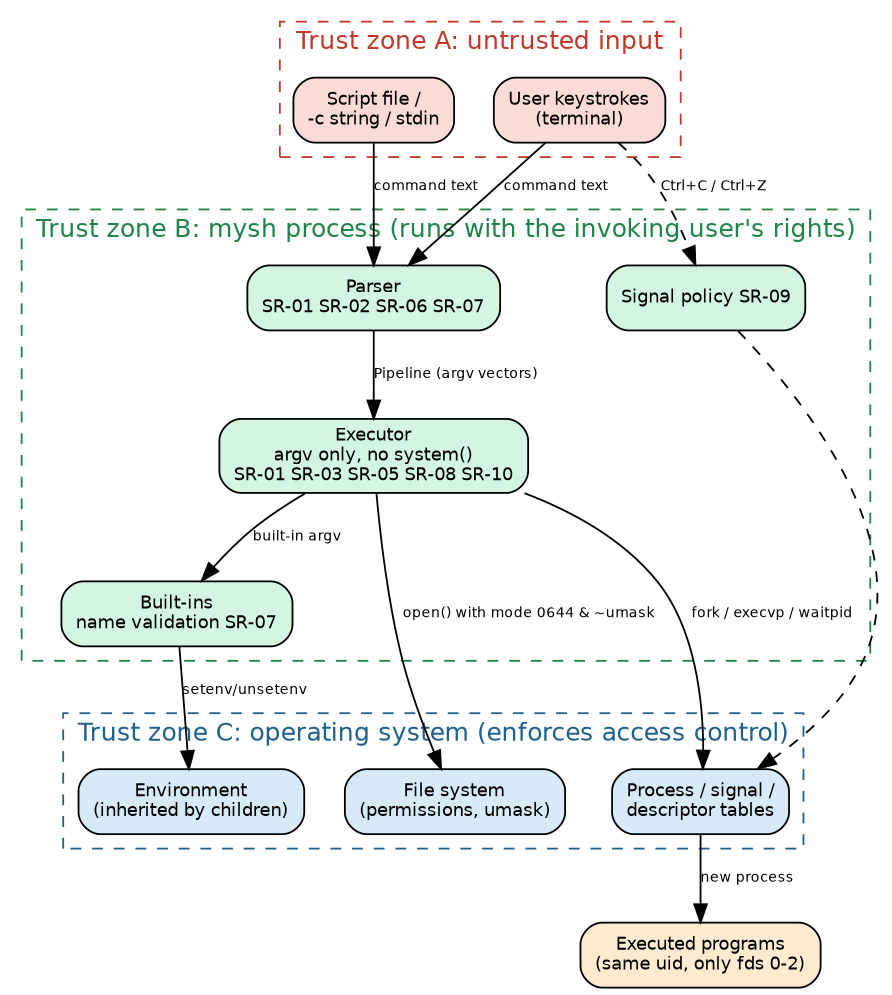
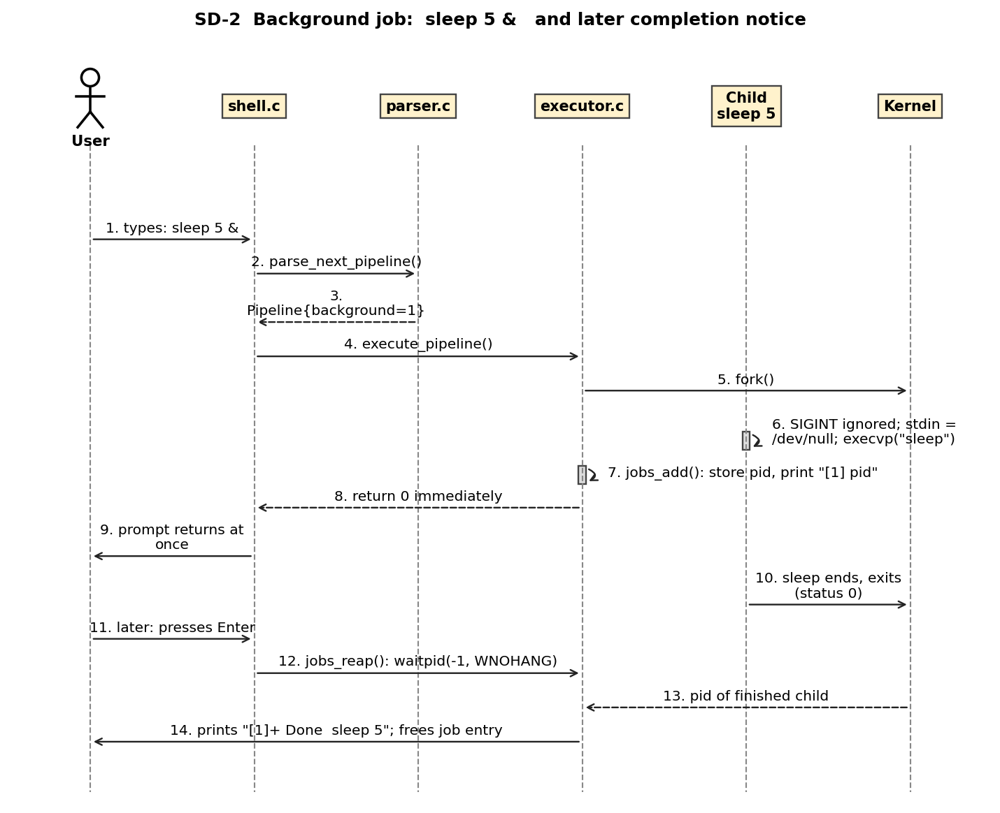
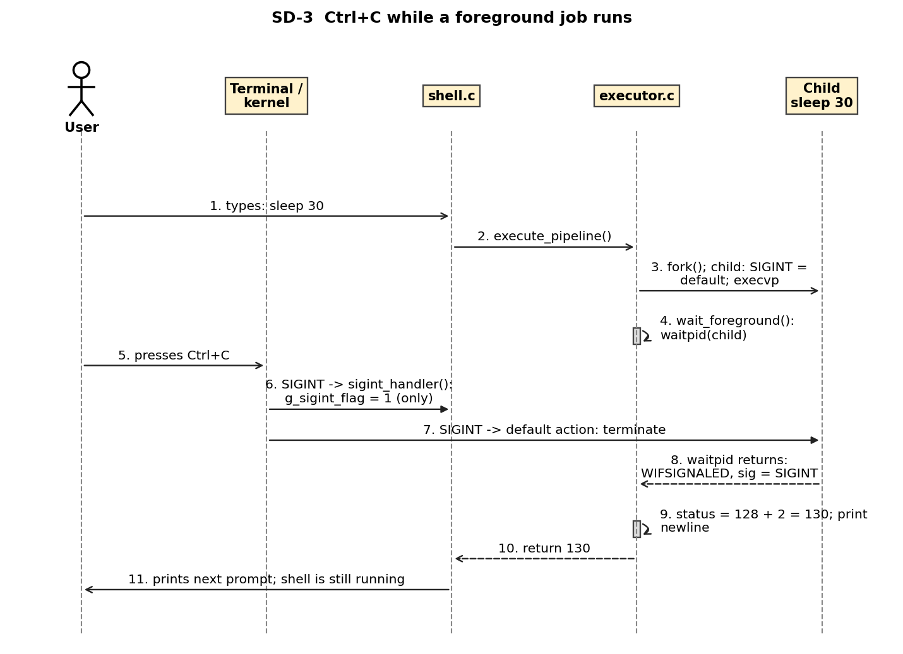
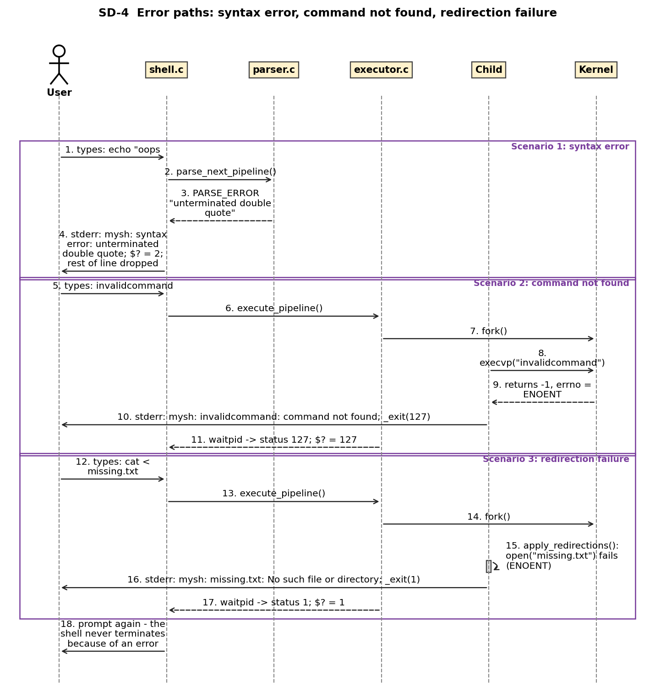

**Project:** Simple Shell (Command Line Interpreter), executable `mysh`  
**Version:** 1.0  
**Authors:** Software Engineering Project 15 team (Member 1, Member 2, Member 3, Member 4)  
**Date:** 2026-10-03  
**Status:** Draft 1.0 - Part-1 submission

# Revision History

| Version | Date | Author | Change Summary |
|---|---|---|---|
| 1.0 | 2026-10-03 | Project team (Members 1-4) | First complete architecture and design specification of the implemented shell |

# Approvals

| Role | Name | Signature/Date |
|---|---|---|
| Team member (design lead) | Member 1 |  |
| Team member (QA / integration) | Member 4 |  |
| Faculty guide / reviewer |  |  |

# 1. Introduction

## 1.1 Purpose

This document specifies the architecture and design of the Simple Shell (`mysh`), a Unix-like command-line interpreter written in C. It describes the structure that exists in the source code under `src/`, why it was chosen, how it traces to the requirements in the SRS, and how security is built in.

## 1.2 Scope

Covers the whole product: reading commands (terminal, script file, `-c`, stdin), parsing, execution of external programs and built-ins, environment handling, redirection, pipelines, background jobs, signals and error handling. It does not cover the operating system, the terminal emulator or the external programs the shell launches.

## 1.3 Audience

Developers (Members 1-4), QA engineers writing and running the test plan, security reviewers, instructors, and future maintainers.

## 1.4 Definitions

SRS (Software Requirements Specification), STP (Software Test Plan), RTM (Requirement Traceability Matrix), ADR (Architecture Decision Record), STRIDE (Spoofing, Tampering, Repudiation, Information disclosure, Denial of service, Elevation of privilege), argv (argument vector), fd (file descriptor), POSIX (Portable Operating System Interface). Further terms are in Appendix 5.1.

# 2. Document Overview

## 2.1 How to use this document

Section 3 gives the architecture (component diagram, pattern, traceability, security architecture). Section 4 gives the design (sequence diagrams, API definitions, error handling, user interaction). Each architecture element has an identifier (ARCH-n) and each design element an identifier (DES-n); both are used by the traceability matrix in the SRS (Appendix C) and by the Test Plan.

## 2.2 Related Documents

SRS v1.0 (`docs/SRS.docx`), Software Test Plan v1.0 (`docs/STP.docx`), RTM (`docs/RTM.md`, SRS Appendix C), README.

# 3. Architecture

## 3.1 Goals & Constraints

**Goals:** correctness first, then robustness, clarity of code, ease of demonstration, and performance (SRS section 6.4). Concretely: execute commands the way a POSIX user expects; never terminate because of a user error; make every behaviour testable without a terminal; keep security properties simple enough to verify (SR-01 to SR-10).

**Constraints:** implementation language C (C11); POSIX interfaces only (`fork`, `execvp`, `pipe`, `dup2`, `waitpid`, `sigaction`); no third-party libraries; single process with no threads; no job control, globbing, `&&`/`||` or line editing (SRS 2.5).

## 3.2 Stakeholders & Concerns

| Stakeholder | Concerns | Addressed by |
|---|---|---|
| End user (student/developer) | Correct behaviour, clear errors, shell never crashes | ARCH-2, ARCH-3, section 4.4 |
| Script author | Predictable parsing and exit codes | ARCH-2, exit-code table in 4.3 |
| Developers / maintainers | Modularity, easy to add built-ins | Component decomposition 3.3-3.4; table-driven built-ins |
| QA engineers | Testability without a terminal | Parser has no process side effects; `-c`/script/stdin modes |
| Security reviewers | Injection, privilege, leaks, memory safety | Section 3.9 |
| Instructors / evaluators | Traceability from requirements to code and tests | Section 3.8, RTM |

## 3.3 Component (UML) Diagram

Six components and their provided/required interfaces (a provided interface is a circle on the providing component; a dashed arrow points at the component that requires it):


## 3.4 Component Descriptions

| ID | Component | Files | Responsibilities | Provided interface |
|---|---|---|---|---|
| ARCH-1 | Shell Core | main.c, shell.c/h | Process entry, option handling (`-c`, script, `--help`, `--version`); owns the `Shell` state (`$?`, running flag, job table); prompt and read-eval loop; EINTR (Ctrl+C) and EOF (Ctrl+D) handling; installs signal policy; executes the pipelines found in a line | IShell: shell_init, shell_run_stream, shell_execute_line, shell_setup_signals, shell_cleanup |
| ARCH-2 | Parser | parser.c/h | Tokenizes one pipeline at a time: blanks, quotes, escapes, comments, operators `\\| < > >> ; &`; expansion of `$NAME ${NAME} $? $$ ~`; builds `Command`/`Pipeline`; detects syntax errors | IParser: parse_next_pipeline, pipeline_free |
| ARCH-3 | Executor | executor.c/h | Runs a `Pipeline`: lone assignment/built-in in the shell process, otherwise fork per command; pipe wiring; redirection with `open`/`dup2`; signal and stdin policy in children; `execvp` and exec-failure codes; foreground wait and status mapping; background job table and reaping | IExecutor: execute_pipeline, jobs_reap |
| ARCH-4 | Built-in Commands | builtins.c/h | Table-driven `cd`, `pwd`, `exit`, `help`, `export`, `unset`, `env`; argument validation | IBuiltins: is_builtin, run_builtin |
| ARCH-5 | Utilities | utils.c/h | xmalloc/xrealloc/xstrdup (abort on out-of-memory), `shell_error`, growable `StrBuf`, identifier validation, trimming | IUtil |
| ARCH-6 | OS interface and signal policy | (system calls) in shell.c, executor.c | fork, execvp, pipe, dup2, open, waitpid, sigaction, chdir, getcwd, environment functions; SIGINT handler and SIGQUIT/SIGTSTP/SIGTTIN/SIGTTOU dispositions | POSIX |

**Dependency rules:** Shell Core -> Parser, Executor; Executor -> Built-ins, Parser data types, Shell state; Built-ins -> Shell state; every component -> Utilities. The Parser never creates processes and never performs I/O other than reading `getenv()`; this is what makes it unit-testable and fuzzable (STP 5.1).

## 3.5 Chosen Architecture Pattern and Rationale

**Pattern: layered architecture with a read-eval loop (interpreter style), using pipes-and-filters at run time.**

* *Layers (top to bottom):* Shell Core (control) -> Parser (language) -> Executor (process management) -> Built-ins -> Utilities/OS. Each layer has one reason to change; the parser knows nothing about processes, the executor knows nothing about quoting.
* *Interpreter / read-eval loop:* `shell_run_stream()` reads a line, `shell_execute_line()` parses and executes one pipeline at a time. This gives correct `$VAR` semantics across `;` without building a full syntax tree.
* *Pipes-and-filters:* a pipeline `a | b | c` runs as concurrent processes (filters) connected by `pipe()` channels; the executor only wires them.
* *Table-driven dispatch:* built-ins are rows in a table (name, function, usage, summary) so `is_builtin()`, `run_builtin()` and `help` share one source of truth.
* *Shared state object:* a single `Shell` structure is passed explicitly (no hidden globals except the async-signal flag `g_sigint_flag`).

**Rejected alternatives**

| Alternative | Why rejected |
|---|---|
| Single file / single function | Not testable in parts; mixes parsing, process control and I/O |
| Full AST for command lists (`&&`, `\|\|`, subshells, control flow) | Out of scope; one-pipeline-at-a-time is simpler and meets the requirements |
| `system()` or `sh -c` to run commands | Would re-interpret user text: violates SO-1/SR-01 |
| `posix_spawn()` | Cannot express the per-child setup needed (dup2, signals, builtin-in-child) as simply; the project also asks for fork/exec explicitly |
| Multi-threaded or client-server design | Unnecessary for a single-user interactive tool; signals and fork do not mix well with threads |

**Architecture decision records**

| ADR | Decision | Consequence |
|---|---|---|
| ADR-1 | Parse and execute one pipeline at a time | `export X=1; echo $X` works; a syntax error in a later segment is found after earlier segments ran (same as common shells) |
| ADR-2 | Run a lone built-in in the shell process; run built-ins inside pipelines or with `&` in a child | `cd`/`exit`/`export` take effect; piped built-ins cannot change the shell (POSIX behaviour) |
| ADR-3 | SIGINT handler only sets a flag; installed without SA_RESTART | Async-signal-safe; blocked `getline()` returns EINTR so the prompt is redrawn |
| ADR-4 | Ignore SIGTSTP/SIGQUIT in the interactive shell (inherited by children) | No job control, so a stopped job could never be resumed; Ctrl+Z does nothing |
| ADR-5 | Expanded text is never re-tokenized (no field splitting) | Closes a class of injection bugs (SR-02); differs from POSIX when a variable holds several words |
| ADR-6 | Every shell variable is an environment variable | Simple model; every variable is visible to children |

## 3.6 Technology Stack & Data Stores

| Item | Choice |
|---|---|
| Language / standard | C11 (also compiles as C99 + POSIX.1-2008) |
| Compiler / build | gcc 13.3, GNU make; flags `-std=c11 -Wall -Wextra -Wpedantic` |
| Libraries | C standard library (glibc) and POSIX system calls only |
| Data stores | None persistent. In memory: `Shell` state, `Pipeline` structures (freed after each pipeline), the process environment (`environ`). The only files written are those the user names in `>`/`>>` (SR-04) |
| Test tooling | C unit-test driver, bash harness, Python `pty` driver, AddressSanitizer/UBSan/LeakSanitizer, parser and process fuzzers |
| Documentation tooling | Graphviz, matplotlib, pandoc, python-docx |

## 3.7 Risks & Mitigations

| Risk | Mitigation | Status |
|---|---|---|
| Zombie processes accumulate from background jobs | `jobs_reap()` with `waitpid(-1, WNOHANG)` before every prompt; foreground children always waited | Mitigated (ST-05) |
| Leaked pipe/redirect descriptors make pipelines hang or leak data to children | Parent closes unused ends immediately; children close originals after `dup2`; script fd opened close-on-exec | Mitigated (SC-09, SC-10, TC-77); one leak (script fd) found and fixed during testing |
| Signal races corrupt state | Handler only sets `volatile sig_atomic_t`; all work done in the main loop | Mitigated (ST-03, ST-04) |
| Malformed input corrupts memory | Dynamic buffers only (`StrBuf`, `getline`); sanitizer and fuzz testing | Mitigated (SC-12, SC-13, ST-12) |
| User runs a fork bomb or exhausts resources | Not prevented by the shell; relies on OS limits such as `ulimit -u` | Accepted |
| PATH contains `.` or an empty entry, so a hostile file in the current directory can be executed | Behaviour is the same as other shells; user is responsible for PATH; documented in SRS 6.3 | Accepted |
| Behaviour differs on non-Linux systems | Only POSIX interfaces used; compiled as C99 + POSIX | Not yet verified on other systems |
| Job-completion notices appear only when the next prompt is drawn | Documented limitation; SIGCHLD-driven notices listed as future work | Accepted |

## 3.8 Traceability to Requirements

Every functional requirement maps to one architecture component and to design elements (DES-n, section 4 and the index below). The complete matrix including test cases is SRS Appendix C and STP section 13.

**Functional requirements**

| Req | Title | Architecture component | Design elements | Source files |
|---|---|---|---|---|
| FR-01 | Interactive prompt and read-eval loop | ARCH-1 Shell Core layer | DES-03, DES-06 | shell.c, parser.c |
| FR-02 | Non-interactive input sources | ARCH-1 Shell Core layer | DES-01, DES-03 | main.c, shell.c |
| FR-03 | Tokenization and quoting | ARCH-2 Parser layer | DES-06, DES-07 | parser.c |
| FR-04 | Syntax error detection and reporting | ARCH-2 Parser layer | DES-06, DES-04 | parser.c, shell.c |
| FR-05 | External command execution with PATH search | ARCH-3 Executor layer | DES-09, DES-10 | executor.c |
| FR-06 | Foreground wait and exit status | ARCH-3 Executor layer | DES-12 | executor.c |
| FR-07 | Invalid command handling | ARCH-3 Executor layer | DES-10 | executor.c |
| FR-08 | Built-in cd | ARCH-4 Built-in Command layer | DES-14, DES-15 | builtins.c |
| FR-09 | Built-in pwd | ARCH-4 Built-in Command layer | DES-14, DES-16 | builtins.c |
| FR-10 | Built-in exit | ARCH-4 Built-in Command layer | DES-14, DES-17 | builtins.c |
| FR-11 | Built-in help | ARCH-4 Built-in Command layer | DES-14, DES-18 | builtins.c |
| FR-12 | Environment variables | ARCH-4 Built-in Command layer | DES-19, DES-20 | builtins.c, executor.c, utils.c |
| FR-13 | Variable and tilde expansion | ARCH-2 Parser layer | DES-08 | parser.c |
| FR-14 | Output redirection > | ARCH-3 Executor layer | DES-11 | executor.c |
| FR-15 | Append redirection >> | ARCH-3 Executor layer | DES-11 | executor.c |
| FR-16 | Input redirection < | ARCH-3 Executor layer | DES-11 | executor.c |
| FR-17 | Redirection error handling | ARCH-3 Executor layer | DES-11, DES-10 | executor.c |
| FR-18 | Pipelines | ARCH-3 Executor layer | DES-09, DES-10 | executor.c |
| FR-19 | Command sequencing with ; | ARCH-1 Shell Core layer | DES-04, DES-06 | shell.c, parser.c |
| FR-20 | Background execution with & | ARCH-3 Executor layer | DES-09, DES-13 | executor.c |
| FR-21 | Signal handling | ARCH-6 Signal / OS interface | DES-05, DES-10, DES-12 | shell.c, executor.c |
| FR-22 | Graceful termination | ARCH-1 Shell Core layer | DES-03, DES-17, DES-02 | shell.c, builtins.c |

**Non-functional and security requirements**

| Req | Component(s) | Design elements | Realised by |
|---|---|---|---|
| NFR-01 Performance | ARCH-3 | DES-09, DES-14 | Built-ins run without fork; background start does not wait |
| NFR-02 Robustness | ARCH-2, ARCH-3, ARCH-5 | DES-06, DES-07, DES-21 | Dynamic buffers, no fixed limits except 64 tracked jobs |
| NFR-03 Usability | ARCH-1, ARCH-4 | DES-03, DES-18, DES-21 | Uniform `shell_error()` format; help table |
| NFR-04 Maintainability | ARCH-1..ARCH-5 | all | Module/header split; built-in table |
| NFR-05 Portability | ARCH-6 | DES-05, DES-09 | POSIX-only interfaces |
| NFR-08 Memory safety | ARCH-2, ARCH-3, ARCH-5 | DES-09, DES-21 | `pipeline_free`, `StrBuf`, descriptor discipline |
| NFR-09 Reliability | ARCH-1, ARCH-3 | DES-04, DES-10 | Errors are per-command; loop always continues |
| SR-01 (SO-1) | ARCH-2, ARCH-3 | DES-07, DES-09, DES-10 | parser.c, executor.c |
| SR-02 (SO-1) | ARCH-2 | DES-07, DES-08 | parser.c |
| SR-03 (SO-2) | ARCH-3 | DES-10 | executor.c |
| SR-04 (SO-3) | ARCH-1, ARCH-3 | DES-03, DES-11 | shell.c, executor.c |
| SR-05 (SO-3) | ARCH-3 | DES-11 | executor.c |
| SR-06 (SO-4) | ARCH-2, ARCH-5 | DES-06, DES-07, DES-21 | parser.c, utils.c |
| SR-07 (SO-4) | ARCH-4 | DES-19, DES-20, DES-21 | builtins.c, executor.c, utils.c |
| SR-08 (SO-5) | ARCH-1, ARCH-3 | DES-01, DES-09, DES-11 | main.c, executor.c |
| SR-09 (SO-5) | ARCH-6 | DES-05, DES-12 | shell.c, executor.c |
| SR-10 (SO-5) | ARCH-3 | DES-10 | executor.c |

## 3.9 Security Architecture

The shell has no network interface, no authentication and no privileged operation; the main threats are untrusted *input* and *unintended exposure* to the programs it launches. Trust zones and the controls placed on each data flow are shown below.



**Security objectives (SRS 6.3):** SO-1 Prevent command and argument injection; SO-2 Prevent privilege escalation; SO-3 Protect user data from unintended disclosure; SO-4 Remain memory-safe and robust against hostile input; SO-5 Prevent resource leakage and loss of control.

**Threat model (STRIDE)**

| Threat | Scenario for mysh | Control (requirement) | Residual risk |
|---|---|---|---|
| Spoofing | A different person runs the shell or a script as the user | None in the shell: identity is the OS user; file permissions protect scripts | Accepted: out of scope |
| Tampering | Crafted text (quotes, `;`, `\|`, `$VAR` contents, file names with metacharacters) alters what is executed; malformed variable names corrupt the environment | argv-only execution and no `system()` (SR-01); no re-scan of expansions (SR-02); name validation (SR-07) | Low; verified by SC-01, SC-02, SC-03, SC-04, SC-08 |
| Repudiation | User denies running a command | None: no history or audit log by design (SR-04) | Accepted; OS-level auditing is out of scope |
| Information disclosure | Secrets stay in a history/log file; files created world-readable; a background job reads terminal input; children inherit open descriptors | No files written on its own (SR-04); mode 0644 & ~umask (SR-05); `/dev/null` stdin for jobs (SR-10); only fds 0-2 inherited (SR-08) | Low; verified by SC-06, SC-07, SC-11, SC-09, SC-10 |
| Denial of service | Hostile or accidental input crashes or hangs the shell; Ctrl+C or Ctrl+Z kills or freezes it; resource exhaustion | Memory-safe parser with fuzzing (SR-06); signal policy (SR-09) | Resource exhaustion (fork bombs) is left to OS limits; accepted |
| Elevation of privilege | The shell or its children gain rights beyond the user's | No setuid-family calls, children keep the shell's ids (SR-03); no shell-in-shell (SR-01) | Low; verified by SC-04, SC-05 |

**Security design rules followed by every component:** (1) user text enters the system only through the parser; (2) the executor receives argv vectors, never command strings; (3) the shell never raises or drops privileges; (4) the shell creates no hidden state; (5) every descriptor not intended for a child is closed or close-on-exec; (6) signal handlers set a flag and nothing else.

**Validation:** STP section 5.1 (static checks, injection tests, descriptor test, permissions test, signal tests, fuzzing, sanitizers).

# 4. Design

## 4.1 Design Overview

The design follows the layers of section 3. Control flow: `main()` -> `shell_run_stream()` (prompt, `getline`, EINTR/EOF) -> `shell_execute_line()` -> loop { `parse_next_pipeline()`, `execute_pipeline()` }. The shell lifecycle and the execution decision tree are shown below; the data-flow view is in SRS section 4.


Key data structures (definitions in the headers):

```c
typedef struct {            /* parser.h */
    char **argv;  int argc; /* NULL-terminated argument vector            */
    char  *infile;          /* '<'  target or NULL                        */
    char  *outfile;         /* '>' / '>>' target or NULL                  */
    int    append;          /* 1 for '>>'                                 */
} Command;

typedef struct {            /* parser.h */
    Command *cmds; int ncmds;
    int      background;    /* 1 when terminated by '&'                   */
    char    *text;          /* trimmed source text                        */
} Pipeline;

typedef enum { PARSE_OK, PARSE_END, PARSE_ERROR } ParseResult;

typedef struct {            /* shell.h */
    int last_status;        /* value of $?                                */
    int running, exit_code, interactive, next_job_id, njobs;
    Job jobs[MAX_JOBS];     /* MAX_JOBS = 64 background jobs              */
} Shell;
```

## 4.2 UML Sequence Diagrams

Four flows specific to this project are modelled (the required minimum is two).

### SD-1 - Foreground pipeline


* The user's line is parsed by `parse_next_pipeline()` into a two-command `Pipeline`.
* `execute_pipeline()` creates one pipe and forks two children; each child attaches its pipe end with `dup2()` and calls `execvp()`.
* The parent closes both pipe ends (so `grep` sees end-of-file when `cat` finishes), waits for both children and returns the status of the last (FR-05, FR-06, FR-18).

### SD-2 - Background job



* The parser sets `background = 1`; the executor forks, the child ignores SIGINT and reads `/dev/null`.
* The parent records the job (`jobs_add`) and returns immediately with status 0 - the prompt is not delayed.
* Before a later prompt `jobs_reap()` collects the finished child with `waitpid(-1, WNOHANG)` and prints the Done notice (FR-20, SR-10).

### SD-3 - Ctrl+C during a foreground job



* The terminal sends SIGINT to the foreground process group: the shell's handler only sets `g_sigint_flag`; the child terminates through the default action.
* `wait_foreground()` sees `WIFSIGNALED`, reports status 128+2 = 130 and prints a newline; the shell stays alive (FR-21, SR-09).

### SD-4 - Error paths



* Syntax error: the parser returns `PARSE_ERROR`, the shell prints the message, sets `$?` = 2 and discards the rest of the line (FR-04).
* Command not found: `execvp()` fails with ENOENT in the child, which prints the message and exits with 127 (FR-07).
* Redirection failure: `apply_redirections()` fails in the child, which prints `file: cause` and exits with 1; the command never runs (FR-17).

## 4.3 API Design

The shell is a command-line program, so its interfaces are (a) C function interfaces between components and (b) the external command-line contract. Interfaces for five components are defined below (the required minimum is two).

### 4.3.1 Parser component (parser.h)

| Item | Definition |
|---|---|
| Function | `ParseResult parse_next_pipeline(const char **cursor, int last_status, Pipeline *out, char *errbuf, size_t errlen)` |
| Request | `cursor`: in/out pointer into the input line; `last_status`: value substituted for `$?`; `out`: caller-allocated `Pipeline`; `errbuf`/`errlen`: buffer for the message |
| Response | `PARSE_OK` (pipeline produced, cursor advanced past `;`, `&` or newline); `PARSE_END` (only blanks/comments remain); `PARSE_ERROR` (message in `errbuf`, cursor moved to end of input, nothing allocated) |
| Errors | unterminated single/double quote; missing file name after `<`, `>`, `>>`; empty pipeline stage (leading, trailing, doubled `\|`); redirection without command; `&&`, `\|\|` unsupported; bad `${...}` substitution; ambiguous redirect (empty file name) |
| Ownership | On `PARSE_OK` the caller must call `pipeline_free()` |
| Function | `void pipeline_free(Pipeline *pl)` - frees all commands, arguments, file names and text; idempotent on a zeroed structure |

### 4.3.2 Executor component (executor.h)

| Item | Definition |
|---|---|
| Function | `int execute_pipeline(Shell *sh, const Pipeline *pl)` |
| Request | `sh`: shell state (job table, interactive flag); `pl`: parsed pipeline (not modified, except that assignment words are temporarily split in place and restored) |
| Response | Exit status of the pipeline (status of the last command): 0-255; 128+N if killed by signal N; 126 not executable; 127 not found; 1 for redirection/fork/pipe failure; background pipelines return 0 immediately |
| Side effects | Creates child processes; for a lone built-in/assignment modifies the shell itself; prints `[id] pid` for background jobs when interactive |
| Errors | `fork()`/`pipe()` failure: message, started children reaped, status 1; exec failure and redirection failure: handled in the child (see 4.4) |
| Function | `void jobs_reap(Shell *sh)` - non-blocking collection of finished background children; prints `[id]+  Done  <command>` when interactive and frees the job entry |

### 4.3.3 Built-in component (builtins.h)

| Item | Definition |
|---|---|
| Functions | `int is_builtin(const char *name)` returns 1 for cd, pwd, exit, help, export, unset, env; `int run_builtin(Shell *sh, int argc, char **argv)` runs it and returns its status |
| Contract | Built-ins write results to stdout and diagnostics to stderr via `shell_error()`; they never terminate the process directly (`exit` sets `sh->running = 0` and `sh->exit_code`) |

Built-in command interface (user-visible):

| Command | Arguments | Result | Errors (status) |
|---|---|---|---|
| cd | `[dir \| -]` | Changes directory; updates PWD/OLDPWD; `cd -` prints the new directory | missing/denied dir (1); more than one argument (1); HOME/OLDPWD unset (1) |
| pwd | none | Prints absolute path | getcwd failure (1) |
| exit | `[n]` | Terminates the shell with n mod 256, or `$?` if omitted | non-numeric (shell exits with 2); too many arguments (1, no exit) |
| help | none | Lists built-ins and operators | none |
| export | `[NAME[=VALUE]...]` | Sets/exports variables; with no argument lists the environment | invalid identifier (1) |
| unset | `NAME...` | Removes variables | invalid identifier (1) |
| env | none | Prints the environment | none |

### 4.3.4 Shell Core component (shell.h)

| Function | Purpose | Returns / errors |
|---|---|---|
| `void shell_init(Shell *sh)` | Zero the state, set running, detect terminal with `isatty` | - |
| `void shell_setup_signals(const Shell *sh)` | Interactive only: SIGINT handler (no SA_RESTART); ignore SIGQUIT, SIGTSTP, SIGTTIN, SIGTTOU | - |
| `int shell_execute_line(Shell *sh, const char *line)` | Parse and execute every pipeline in `line`; stops on syntax error (status 2) or when `exit` ran | Last status |
| `int shell_run_stream(Shell *sh, FILE *in)` | Read-eval loop: reap jobs, prompt (interactive), `getline`, EINTR -> redraw, EOF -> leave | Exit code of the shell |
| `void shell_cleanup(Shell *sh)` | Free job table entries | - |

### 4.3.5 Command-line interface of `mysh`

| Invocation | Behaviour | Exit status |
|---|---|---|
| `mysh` | Interactive if stdin is a terminal (prompt `mysh:<cwd>$ ` on stderr); otherwise reads commands from stdin silently | Status of last command / `exit` argument |
| `mysh -c "cmd"` | Executes the string and exits | Status of last command; 2 if `-c` has no argument |
| `mysh script_file` | Executes the file (opened close-on-exec) | Status of last command; 127 if the file cannot be opened |
| `mysh --help` / `--version` | Prints usage / version | 0 |

**Exit status contract:** 0 success; 1 general failure; 2 syntax error or usage; 126 found but not executable; 127 not found; 128+N killed by signal N (130 = SIGINT).

## 4.4 Error Handling, Logging & Monitoring

**Principles:** errors are reported where they are detected with `shell_error()` in the single format `mysh: <subject>: <cause>` on stderr; an error affects only the current command or line; the main loop always continues (NFR-09). No sensitive information is ever written to a log because the shell keeps none (SR-04).


| Error class | Detected in | Message example | Status | Shell continues? |
|---|---|---|---|---|
| Syntax error | parser.c | `mysh: syntax error: unterminated double quote` | 2 | Yes, rest of the line discarded |
| Command not found | exec_child (ENOENT) | `mysh: foo: command not found` | 127 | Yes |
| Not executable / other exec failure | exec_child | `mysh: ./f: Permission denied` | 126 | Yes |
| Redirection failure | apply_redirections | `mysh: missing.txt: No such file or directory` | 1 | Yes, command not run |
| Built-in misuse | builtins.c | `mysh: cd: too many arguments` | 1 | Yes |
| fork()/pipe() failure | execute_pipeline | `mysh: fork: Resource temporarily unavailable` | 1 | Yes, started children are reaped |
| Killed by signal | wait_foreground | `Segmentation fault` (strsignal) | 128+N | Yes (SIGINT prints only a newline, SIGPIPE nothing) |
| Out of memory | utils.c (xmalloc) | `mysh: out of memory` | 1 | No: the shell exits (deliberate; cannot continue safely) |

**Logging:** none by design (SR-04). **Monitoring:** the exit status `$?` is the observable health signal of every command; the test suites (STP) are the monitoring mechanism for the shell itself, including a sanitizer build that turns memory errors into failures.

## 4.5 UX Design

* Prompt `mysh:<cwd>$ ` (written to stderr so redirected output stays clean); plain text only, no colour, so it works with screen readers and any terminal.
* Keys: Ctrl+C abandons the line or stops the foreground job; Ctrl+D at an empty prompt exits (prints `exit`); Ctrl+Z and Ctrl+\ are ignored.
* Background jobs: `[1] 4242` on start and `[1]+  Done                    sleep 5` before a later prompt.
* `help` fits one screen (17 lines, widest 60 columns; NF-08); error messages name the failing command or file and the cause.

## 4.6 Open Issues & Next Steps

* No job control (`jobs`, `fg`, `bg`) - needs process groups and terminal control.
* Done notices only at the next prompt - could be driven by SIGCHLD.
* No globbing, `&&`, `||`, `2>`, command substitution, history or line editing.
* Every variable is exported; no local shell variables.
* Verification on non-Linux POSIX systems is still to be done.

# 5. Appendices

## 5.1 Glossary

| Term | Meaning |
|---|---|
| argv | NULL-terminated array of argument strings passed to a program |
| Pipeline | Commands joined by `\|`, run concurrently |
| Foreground / background | Shell waits / does not wait for the pipeline |
| Zombie | Terminated child whose status has not been collected |
| fd | File descriptor: small integer naming an open file or pipe |
| Close-on-exec | Descriptor flag that closes it automatically when a program is executed |
| STRIDE | Threat classification (Spoofing, Tampering, Repudiation, Information disclosure, Denial of service, Elevation of privilege) |
| ADR | Architecture Decision Record |

## 5.2 References

1. ISO/IEC/IEEE 42010:2011, Systems and software engineering - Architecture description.
2. IEEE Std 1016-2009, Software Design Descriptions.
3. The Open Group, POSIX.1-2008, Shell Command Language and System Interfaces.
4. OWASP, Secure Coding Practices Quick Reference Guide.
5. SEI CERT C Coding Standard (e.g. SIG30-C async-signal-safe handlers, FIO22-C close files before spawning).
6. W. R. Stevens, S. A. Rago, *Advanced Programming in the UNIX Environment*, 3rd ed.
7. Project documents: SRS v1.0, STP v1.0, RTM.

## 5.3 Tools

Graphviz and matplotlib (diagrams, generated by `docs/diagrams/make_diagrams.py`), pandoc and python-docx (Word output), gcc/make, AddressSanitizer/UBSan/LeakSanitizer, bash and Python `pty` test drivers.

## 5.4 Design reference index

| Design ref | Function / element | File |
|---|---|---|
| DES-01 | main() - option handling (-c, script, --help, --version) | main.c |
| DES-02 | shell_init() / shell_cleanup() - state and lifecycle | shell.c |
| DES-03 | shell_run_stream() - prompt, getline, EINTR and EOF handling | shell.c |
| DES-04 | shell_execute_line() - parse/execute loop over pipelines | shell.c |
| DES-05 | shell_setup_signals() and sigint_handler() | shell.c |
| DES-06 | parse_next_pipeline() - grammar, operators, syntax errors | parser.c |
| DES-07 | read_word() - quoting, escapes, comment handling | parser.c |
| DES-08 | expand_dollar() and tilde expansion | parser.c |
| DES-09 | execute_pipeline() - fork loop, pipe wiring, wait/background | executor.c |
| DES-10 | exec_child() - child setup, execvp, exec failure codes | executor.c |
| DES-11 | apply_redirections() - open/dup2 for <, >, >> | executor.c |
| DES-12 | wait_foreground() - waitpid and status mapping | executor.c |
| DES-13 | jobs_add() / jobs_reap() - background job table | executor.c |
| DES-14 | Built-in table, is_builtin(), run_builtin(), run_builtin_in_parent() | builtins.c, executor.c |
| DES-15 | bi_cd() | builtins.c |
| DES-16 | bi_pwd() | builtins.c |
| DES-17 | bi_exit() | builtins.c |
| DES-18 | bi_help() | builtins.c |
| DES-19 | bi_export(), bi_unset(), bi_env() | builtins.c |
| DES-20 | all_assignments() / run_assignments() - NAME=VALUE | executor.c |
| DES-21 | utils: StrBuf, xmalloc/xrealloc, shell_error, is_valid_name | utils.c |

| Architecture ref | Component | Files | Figures |
|---|---|---|---|
| ARCH-1 | Shell Core layer | main.c, shell.c | Fig. 1, Fig. 3 |
| ARCH-2 | Parser layer | parser.c | Fig. 1, Fig. 2 |
| ARCH-3 | Executor layer | executor.c | Fig. 1, Fig. 4, Fig. 6 |
| ARCH-4 | Built-in Command layer | builtins.c | Fig. 1, Fig. 2 |
| ARCH-5 | Utility layer | utils.c | Fig. 1 |
| ARCH-6 | Signal / OS interface | shell.c, executor.c | Fig. 1, Fig. 8 |
