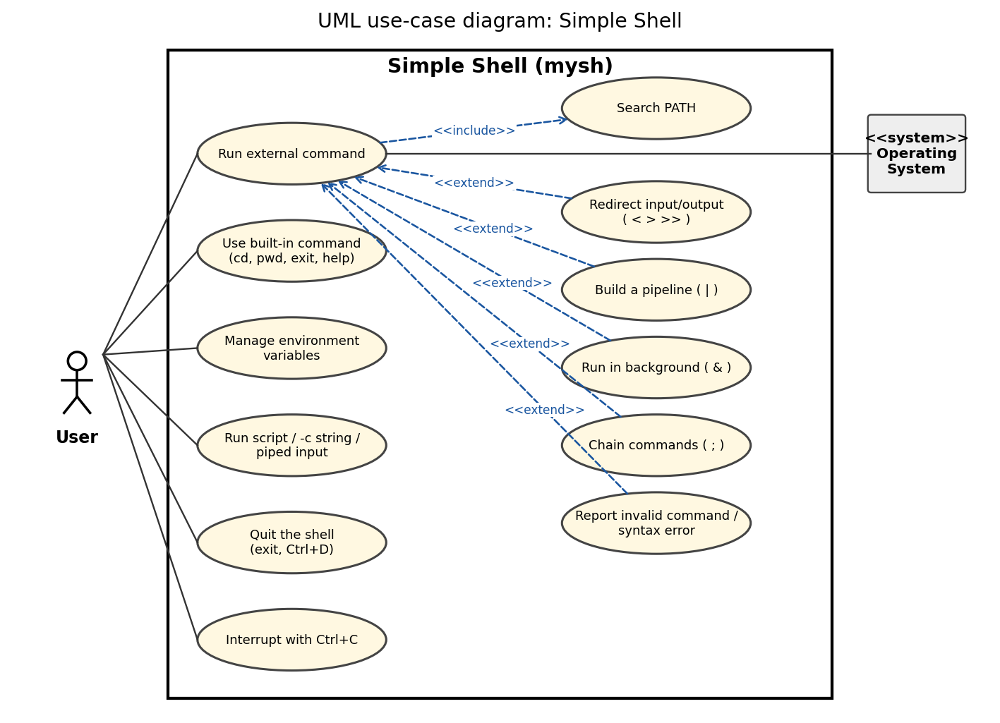
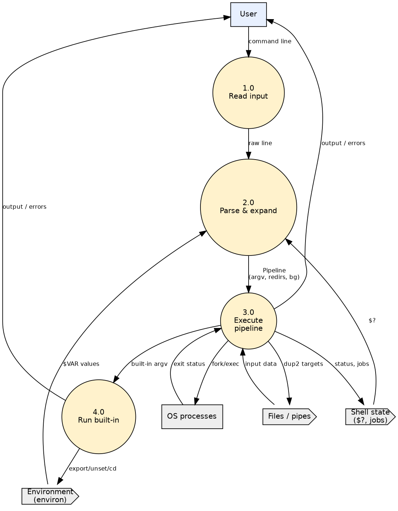
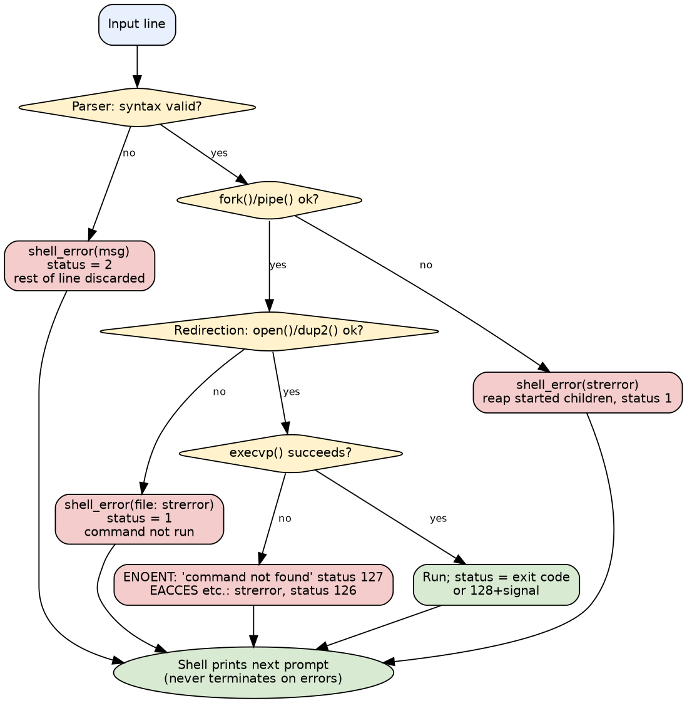

**PES UNIVERSITY, BANGALORE**

**Department of Computer Science and Engineering**

**Software Requirements Specification: Simple Shell (Command Line Interpreter)**

**Version 1.0 approved**

**Prepared by:** Software Engineering Project 15 team (Member 1, Member 2, Member 3, Member 4)

**Organization:** Department of Computer Science and Engineering, PES University, Bangalore

**Date created:** 2026-10-03

## Revision History

| Name | Date | Reason For Changes | Version |
|---|---|---|---|
| Project team (Members 1-4) | 2026-10-03 | Initial release describing the implemented shell | 1.0 |

# 1. Introduction

## 1.1 Purpose

This document specifies the software requirements of **Simple Shell (Command Line Interpreter)** (executable `mysh`, release 1.0): a simple Unix-like command-line interpreter written in C. It covers the whole product; the shell is a self-contained program and is not a subsystem of a larger system.

## 1.2 Intended Audience

* **Developers** (Members 1-4) use sections 3-6 and the RTM (Appendix C) to implement and change the shell.
* **Testers** use section 5 and Appendix C to derive and trace test cases (`docs/STP.docx`).
* **Faculty / evaluators** use the whole document to assess completeness and consistency.
* **Users** (students running the shell) use sections 2 and 3.1.

Section 2 gives the overall picture, section 3 the interfaces, section 4 the analysis models, section 5 the functional requirements grouped by feature, section 6 the non-functional requirements, and the appendices the glossary, the command grammar and status codes, and the traceability matrix.

## 1.3 Product Scope

`mysh` reads a line of text, interprets it and asks the operating system to run the requested programs. It lets a user run programs found in PATH, use the built-ins cd, pwd, exit, help, export, unset and env, manage environment variables, redirect input and output with `<`, `>` and `>>`, connect commands with pipes, chain commands with `;`, run commands in the background with `&`, and stay in control when pressing Ctrl+C. The purpose is to demonstrate the core mechanisms of a Unix shell (process creation, execution, waiting, descriptors and signals) in a well-structured, tested C code base. Out of scope: job control (fg/bg/jobs), wildcard expansion, command substitution, `&&`/`||`, control-flow scripting, line editing and history (see section 2.5).

## 1.4 References

1. Project Guidelines and SRS template supplied for Software Engineering Project 15, PES University (SRS-Document.docx).
2. IEEE Std 830-1998, Recommended Practice for Software Requirements Specifications.
3. The Open Group, POSIX.1-2008 (IEEE Std 1003.1-2008): Shell Command Language; `fork`, `execvp`, `pipe`, `dup2`, `waitpid`, `sigaction`.
4. W. Richard Stevens, Stephen Rago, *Advanced Programming in the UNIX Environment*, 3rd ed., Addison-Wesley, 2013.
5. Project documents in this repository: `docs/DESIGN.md`, `docs/STP.docx`, `docs/RTM.md`, `README.md`.

# 2. Overall Description

## 2.1 Product Perspective

`mysh` is a new, self-contained product; it replaces no existing system. It sits between the user's terminal (or a script) and the operating-system kernel, as shown in Figure 1. Its only external interfaces are the terminal/stdin/stdout/stderr, the file system, the process and signal interface of the OS, and the programs it launches.


## 2.2 Product Functions

* Interactive prompt and read-eval loop; execution of scripts, `-c` strings and piped input
* Tokenizing and parsing with quotes, escapes, comments and syntax-error reporting
* Execution of external programs with PATH search; exit-status tracking (`$?`)
* Built-ins: cd, pwd, exit, help, export, unset, env
* Environment variables and `$VAR`, `${VAR}`, `$?`, `$$`, `~` expansion
* Redirection `<`, `>`, `>>`; pipelines `|`; sequencing `;`
* Background execution `&` with completion notices
* Signal handling (Ctrl+C, Ctrl+Z, Ctrl+D) and graceful termination

## 2.3 User Classes and Characteristics

| User class | Characteristics | Importance |
|---|---|---|
| Student / developer user | Comfortable with a terminal; uses the shell interactively to run programs and build pipelines | Most important |
| Script author | Writes text files of commands and runs `mysh script` or `mysh -c` | Important |
| Evaluator / tester | Runs the demo and test suites; reads messages and exit codes | Important |
| Maintainer | Extends the C code (e.g. adds a built-in) | Less frequent |

No privilege levels exist; the shell runs with the rights of the invoking user.

## 2.4 Operating Environment

Linux or another POSIX system with a C11 compiler (gcc 13.3 tested), GNU make, and the standard utilities used in commands (`ls`, `cat`, `grep`, `sort`, `sleep`). Tested only on Ubuntu 24.04. No third-party libraries are required. A terminal emulator is required for interactive use. Bash and Python 3 are needed only to run the test suites.

## 2.5 Design and Implementation Constraints

* Language: C (C11), using POSIX system calls; no external libraries.
* Process creation with `fork()` and program loading with the `exec` family (project requirement).
* Command input via `getline()`: no line editing, no history, no tab completion.
* No job control: `fg`, `bg`, `jobs` and Ctrl+Z suspension are not provided; Ctrl+Z and Ctrl+\ are ignored.
* Not supported: wildcard/glob expansion, command substitution, `&&`, `||`, here-documents, `2>`/`&>` redirection, aliases, functions and control flow, `~user`.
* At most 64 background jobs are tracked for notification.
* Coding conventions: one module per concern, headers document interfaces, warnings enabled (`-Wall -Wextra -Wpedantic`).

## 2.6 Assumptions and Dependencies

* The host provides a POSIX kernel with working `fork`, `pipe` and signals, and the utilities named in the tests.
* `PATH` and `HOME` are set by the parent environment; if `HOME` is unset, `cd` without argument reports an error.
* Input is text in the terminal's encoding; the shell treats bytes opaquely.
* The terminal delivers Ctrl+C as SIGINT to the foreground process group.

# 3. External Interface Requirements

## 3.1 User Interfaces

The user interface is a text terminal.

* **Prompt:** `mysh:<current directory>$ ` written to standard error (so it does not pollute redirected output); shown only when standard input is a terminal.
* **Input:** one command line per Enter; Ctrl+C abandons the line; Ctrl+D at an empty prompt exits.
* **Messages:** all diagnostics are written to standard error as `mysh: <detail>`; program output goes to standard output.
* **Job notices:** `[id] pid` when a background job starts; `[id]+  Done                    <command>` when it has finished, shown before a later prompt (interactive mode only).
* **Help:** the `help` built-in lists all built-ins and operators. Command-line options: `mysh [-c command | script_file]`, `mysh --help`, `mysh --version`.

## 3.2 Software Interfaces

| Interface | Purpose |
|---|---|
| Operating system (Linux, POSIX.1-2008) | `fork`, `execvp`, `pipe`, `dup2`, `open`, `close`, `waitpid`, `sigaction`, `chdir`, `getcwd`, `getenv`/`setenv`/`unsetenv`, `isatty` |
| C standard library (glibc) | I/O, memory, string functions, `getline` |
| Launched programs | Any executable in PATH; they receive argv, the environment and redirected descriptors, and return an exit status |
| File system | Files named in `<`, `>`, `>>`, script files, working directory |

Data passed in: command text, environment. Data passed out: program output, exit status (`$?` and the shell's own exit code), diagnostics.

## 3.3 Communications Interfaces

The shell has no network communication. Inter-process communication is limited to anonymous pipes created for `|` and to signals (SIGINT and the default SIGPIPE/SIGCHLD behaviour).

## 3.4 Hardware Interfaces

None directly. The terminal device is accessed through the operating system's standard descriptors 0, 1 and 2.

# 4. Analysis Models



The diagram above is the UML use-case diagram (actors: **User** and the secondary actor **Operating System**; `<<extend>>` and `<<include>>` relationships between use cases). Use cases UC1-UC12 correspond to the features in section 5:

| Use case | Actor | Description | Related requirements |
|---|---|---|---|
| UC1 Run external command | User, OS | User types a program name with arguments; shell searches PATH, runs it and reports status | FR-05, FR-06, FR-07 |
| UC2 Use built-in command | User | cd, pwd, exit, help run inside the shell | FR-08 to FR-11 |
| UC3 Manage environment variables | User | export, unset, env, NAME=VALUE, $VAR expansion | FR-12, FR-13 |
| UC4 Run script / -c / piped input | User | Commands read from a file, a string or stdin without a prompt | FR-02 |
| UC5 Quit the shell | User | exit or Ctrl+D ends the session with the proper status | FR-10, FR-22 |
| UC6 Interrupt with Ctrl+C | User | Stops the foreground job or abandons the input line; shell stays alive | FR-21 |
| UC7 Redirect input/output (extends UC1) | User, OS | < > >> connect standard streams to files | FR-14 to FR-17 |
| UC8 Build a pipeline (extends UC1) | User, OS | Commands joined by \| run concurrently | FR-18 |
| UC9 Run in background (extends UC1) | User, OS | & starts a job and returns to the prompt at once | FR-20 |
| UC10 Chain commands (extends UC1) | User | ; runs commands one after another | FR-19 |
| UC11 Report invalid command / syntax error (extends UC1) | User | Diagnostic message and status; shell continues | FR-04, FR-07, FR-17 |
| UC12 Search PATH (included by UC1) | OS | Locate the executable named by the user | FR-05 |








# 5. System Features

Requirement identifiers use the tag **FR-nn** (functional requirement, unique across the document); each is verified by at least one executed test listed in Appendix C.

## 5.1 Command Loop and Input Sources

### 5.1.1 Description and Priority

Reads commands interactively, from stdin, from a script or from -c and terminates cleanly. Priority: **High**.

### 5.1.2 Stimulus/Response Sequences

* User starts mysh -> prompt appears.
* User types a line and presses Enter -> line is executed, prompt returns.
* User presses Ctrl+D or types exit -> shell terminates.

### 5.1.3 Functional Requirements

**FR-01 - Interactive prompt and read-eval loop** (Priority: High)

When standard input is a terminal the shell shall display a prompt containing the current working directory, read one line, execute it, and repeat until told to exit.

*Expected behaviour:* Prompt has the form mysh:<cwd>$ and is written to stderr. Blank, whitespace-only and comment-only lines are accepted and do nothing (status unchanged).

*Error/exception behaviour:* If getcwd() fails the prompt falls back to mysh$ . A failed read caused by a signal redraws the prompt (see FR-21).

**FR-02 - Non-interactive input sources** (Priority: High)

The shell shall accept commands from (a) a terminal, (b) standard input when it is not a terminal, (c) a script file argument, and (d) a command string given with -c. --help and --version shall print information and exit.

*Expected behaviour:* No prompt is printed and no job banners are shown in non-interactive modes. The exit status is the status of the last command, or the value given to exit.

*Error/exception behaviour:* -c without an argument prints a usage message and exits with status 2. An unreadable script file prints an error and exits with status 127.

**FR-22 - Graceful termination** (Priority: High)

The shell shall terminate cleanly (freeing its state and returning the proper exit status) on exit or on end-of-input (Ctrl+D interactively, EOF on a pipe or file).

*Expected behaviour:* Interactively 'exit' is printed on Ctrl+D. The exit status is that of the last command (or the exit argument).

*Error/exception behaviour:* None.

## 5.2 Command-Line Parsing

### 5.2.1 Description and Priority

Turns a line of text into commands, arguments, redirections and operators; reports syntax errors. Priority: **High**.

### 5.2.2 Stimulus/Response Sequences

* User types echo "a  b" -> one argument 'a  b' is passed.
* User types ls | -> 'syntax error' message, prompt returns.

### 5.2.3 Functional Requirements

**FR-03 - Tokenization and quoting** (Priority: High)

The parser shall split a line into words separated by blanks; single quotes shall preserve text literally, double quotes shall preserve blanks and operators but allow expansion, a backslash shall escape the next character, and text after an unquoted # at the start of a word shall be a comment.

*Expected behaviour:* Operators | < > >> ; & are recognised without surrounding spaces (echo x>f). Quoted operators are ordinary text.

*Error/exception behaviour:* Unterminated quotes are syntax errors (FR-04).

**FR-04 - Syntax error detection and reporting** (Priority: High)

The parser shall detect and report: unterminated single or double quotes, a redirection operator with no file name, an empty pipeline stage (leading, trailing or doubled |), a redirection with no command, a malformed ${...}, and the unsupported operators && and ||.

*Expected behaviour:* A message of the form 'mysh: <reason>' is written to stderr, $? is set to 2, and the remainder of the input line is discarded. The shell continues with the next line.

*Error/exception behaviour:* No command from the faulty pipeline is executed. The shell never terminates because of a syntax error.

## 5.3 External Command Execution

### 5.3.1 Description and Priority

Runs programs found via PATH in child processes and reports their exit status. Priority: **High**.

### 5.3.2 Stimulus/Response Sequences

* User types ls -> child runs ls, output shown, prompt returns.
* User types nosuchcmd -> 'command not found', status 127.

### 5.3.3 Functional Requirements

**FR-05 - External command execution with PATH search** (Priority: High)

For a command that is not a built-in the shell shall create a child process with fork() and replace it with the program using execvp(), searching the directories in PATH when the name contains no slash.

*Expected behaviour:* Arguments are passed unchanged (after quote removal and expansion) as argv. A name containing / is used as a path and is not searched in PATH.

*Error/exception behaviour:* See FR-07 for exec failures. If fork() or pipe() fails, already-started children are reaped, an error is printed and the status is 1.

**FR-06 - Foreground wait and exit status** (Priority: High)

The shell shall wait for every foreground child before reading the next command and shall record the exit status of the last command of a pipeline in $?.

*Expected behaviour:* Normal exit -> exit code. Death by signal N -> 128+N and a message (strsignal) on stderr, except SIGINT (newline only) and SIGPIPE (silent).

*Error/exception behaviour:* waitpid() interrupted by a signal is retried.

**FR-07 - Invalid command handling** (Priority: High)

When a command cannot be executed the shell shall print a diagnostic, set the status and continue.

*Expected behaviour:* Name not found in PATH -> 'mysh: <name>: command not found', status 127. Path with / not found -> 'No such file or directory', status 127. Found but not executable (e.g. EACCES) -> strerror message, status 126.

*Error/exception behaviour:* The child exits; the shell prompts again.

## 5.4 Built-in Commands

### 5.4.1 Description and Priority

Commands implemented inside the shell process: cd, pwd, exit, help. Priority: **High** (contains Medium items: FR-11).

### 5.4.2 Stimulus/Response Sequences

* User types cd .. -> working directory changes and stays changed.
* User types help -> list of built-ins printed.

### 5.4.3 Functional Requirements

**FR-08 - Built-in cd** (Priority: High)

cd [dir] shall change the working directory of the shell process itself; cd with no argument shall use $HOME; cd - shall return to $OLDPWD and print the new directory. PWD and OLDPWD shall be updated.

*Expected behaviour:* Runs in the shell process (not a child) so the change persists.

*Error/exception behaviour:* Missing/inaccessible directory -> 'cd: <dir>: <strerror>', status 1. More than one argument -> 'too many arguments', status 1. HOME or OLDPWD unset when needed -> error, status 1.

**FR-09 - Built-in pwd** (Priority: High)

pwd shall print the absolute path of the current working directory followed by a newline.

*Expected behaviour:* Output can be redirected or piped like any command.

*Error/exception behaviour:* If getcwd() fails, 'pwd: <strerror>' and status 1.

**FR-10 - Built-in exit** (Priority: High)

exit [n] shall terminate the shell with status n (0-255, taken modulo 256), or with the status of the last command when n is omitted. Remaining input is not executed.

*Expected behaviour:* Background jobs are not signalled; they are left running.

*Error/exception behaviour:* Non-numeric argument -> 'exit: <arg>: numeric argument required' and the shell exits with status 2. More than one argument -> error, shell does not exit, status 1.

**FR-11 - Built-in help** (Priority: Medium)

help shall print the list of built-in commands with usage and a summary of the supported operators and variable forms.

*Expected behaviour:* Output goes to stdout and can be redirected.

*Error/exception behaviour:* None (always status 0).

## 5.5 Environment and Expansion

### 5.5.1 Description and Priority

Environment variables and $-expansion. Priority: **High**.

### 5.5.2 Stimulus/Response Sequences

* User types export NAME=x then echo $NAME -> x is printed.
* User types echo ${UNSET} end -> only 'end' printed.

### 5.5.3 Functional Requirements

**FR-12 - Environment variables** (Priority: High)

The shell shall let the user set, remove and list environment variables: export NAME=VALUE, export NAME, unset NAME..., env, and a bare NAME=VALUE command. Variables are visible to child processes.

*Expected behaviour:* Shell variables and environment variables are the same set (every variable is exported). A line consisting only of assignments sets them in the shell process.

*Error/exception behaviour:* An invalid identifier -> "<cmd>: '<arg>': not a valid identifier", status 1.

**FR-13 - Variable and tilde expansion** (Priority: High)

Outside single quotes the parser shall expand $NAME, ${NAME}, $? (last status), $$ (shell PID), and a leading ~ (or ~/...) to $HOME. Expansion of one pipeline happens after the previous pipeline finished.

*Expected behaviour:* An unset variable expands to nothing; an unquoted expansion that yields an empty string is dropped, a quoted one is kept as an empty argument. A lone $ is literal.

*Error/exception behaviour:* Malformed ${...} -> 'bad substitution' syntax error (FR-04). ~user is not supported and stays literal.

## 5.6 I/O Redirection

### 5.6.1 Description and Priority

Connects standard input/output of a command to files. Priority: **High**.

### 5.6.2 Stimulus/Response Sequences

* User types echo hi > f -> f contains hi.
* User types cat < missing -> error message, status 1.

### 5.6.3 Functional Requirements

**FR-14 - Output redirection >** (Priority: High)

cmd > file shall send the standard output of cmd to file, creating it (mode 0644 before umask) or truncating it.

*Expected behaviour:* Works for external commands and built-ins. If > is given more than once the last target is used.

*Error/exception behaviour:* See FR-17.

**FR-15 - Append redirection >>** (Priority: High)

cmd >> file shall append the standard output of cmd to file, creating it if it does not exist.

*Expected behaviour:* Existing content is preserved.

*Error/exception behaviour:* See FR-17.

**FR-16 - Input redirection <** (Priority: High)

cmd < file shall connect the standard input of cmd to file.

*Expected behaviour:* Works for external commands and built-ins; in a pipeline an explicit < on the first command replaces the inherited input.

*Error/exception behaviour:* See FR-17.

**FR-17 - Redirection error handling** (Priority: High)

If a redirection target cannot be opened the command shall not run, the shell shall print '<file>: <strerror>' and the status shall be 1.

*Expected behaviour:* For built-ins run in the shell process the standard descriptors are restored, so the shell itself is unaffected.

*Error/exception behaviour:* Example: cat < missing.txt; echo hi > nodir/x.

## 5.7 Pipelines and Sequencing

### 5.7.1 Description and Priority

Connects commands with pipes and runs commands one after another with ;. Priority: **High** (contains Medium items: FR-19).

### 5.7.2 Stimulus/Response Sequences

* User types cat f | grep x -> only matching lines are shown.
* User types echo a; echo b -> a then b.

### 5.7.3 Functional Requirements

**FR-18 - Pipelines** (Priority: High)

cmd1 | cmd2 | ... shall run all commands concurrently, connecting standard output of each to standard input of the next with pipe(). The pipeline status is that of the last command. There is no fixed limit on the number of stages.

*Expected behaviour:* Built-ins used inside a pipeline run in a child process. Parent closes all unused pipe ends so readers see end-of-file.

*Error/exception behaviour:* A stage that fails to exec does not block the others (its pipe end closes). A syntax error is reported per FR-04.

**FR-19 - Command sequencing with ;** (Priority: Medium)

Pipelines separated by ; (or a newline) shall be executed one after another regardless of the earlier status.

*Expected behaviour:* Each pipeline is parsed just before it runs, so 'export X=1; echo $X' prints 1.

*Error/exception behaviour:* A syntax error stops processing of the rest of that line (FR-04).

## 5.8 Background Execution

### 5.8.1 Description and Priority

Runs a pipeline without blocking the shell. Priority: **High**.

### 5.8.2 Stimulus/Response Sequences

* User types sleep 5 & -> [1] <pid> shown, prompt returns at once.
* Job finishes -> '[1]+ Done sleep 5' shown before a later prompt.

### 5.8.3 Functional Requirements

**FR-20 - Background execution with &** (Priority: High)

A pipeline terminated by & shall be started and the shell shall immediately continue without waiting. Interactively the shell prints [id] pid on start and [id]+ Done <command> when it has finished (reported before the next prompt).

*Expected behaviour:* Background processes read from /dev/null unless redirected, ignore SIGINT, and are reaped with waitpid(WNOHANG) so they do not remain zombies. Status of the & pipeline is 0.

*Error/exception behaviour:* If the job table (64 entries) is full the job still runs but is not reported.

## 5.9 Signal Handling

### 5.9.1 Description and Priority

Keeps the shell alive on Ctrl+C / Ctrl+Z and lets Ctrl+C stop foreground jobs. Priority: **High**.

### 5.9.2 Stimulus/Response Sequences

* User presses Ctrl+C during sleep 30 -> sleep dies, prompt returns, $? is 130.
* User presses Ctrl+C at an empty prompt -> new prompt.

### 5.9.3 Functional Requirements

**FR-21 - Signal handling** (Priority: High)

In interactive mode Ctrl+C shall interrupt the current input line or foreground job without terminating the shell; Ctrl+\ and Ctrl+Z shall not stop or kill the shell or its foreground jobs (no job control).

*Expected behaviour:* At the prompt Ctrl+C abandons the line, prints a newline, sets $? to 130 and redraws the prompt. A foreground child receives the default SIGINT action; the shell reports status 130. Background jobs are not affected by Ctrl+C.

*Error/exception behaviour:* SIGPIPE keeps its default action in children.


# 6. Other Nonfunctional Requirements

## 6.1 Performance Requirements

Measurable performance requirements are given in NFR-01 (section 6.4): a background start returns within 500 ms, 1000 external commands run within 5 s and 1000 built-ins within 1 s on the reference environment. Rationale: the prompt must stay responsive; run time of external programs is outside the shell's control, so thresholds are generous regression bounds, not hardware promises.

## 6.2 Safety Requirements

The shell is not safety-critical. Actions that must be prevented: the shell being terminated by Ctrl+C or Ctrl+\ during normal use; a failed redirection running the command anyway (FR-17); descriptor leaks that could block pipeline readers (FR-18). The shell does not add safeguards against destructive commands such as `rm -rf`; the user is responsible for the commands typed.

## 6.3 Security Requirements

### 6.3.1 Security Objectives

The shell runs with the rights of the invoking user, has no network interface and no authentication of its own. The main assets are the user's files and environment, and the integrity of what the user asked to run. The objectives are:

| ID | Objective | Description |
|---|---|---|
| SO-1 | Prevent command and argument injection | User-supplied text (typed, scripted or stored in a variable) must never be interpreted as shell syntax, or as another program's command line, unless the user typed that syntax unquoted. |
| SO-2 | Prevent privilege escalation | The shell must not give itself or the programs it starts more privilege than the invoking user already has. |
| SO-3 | Protect user data from unintended disclosure | The shell must not store or log what the user types, and files it creates must not be more accessible than the user's umask intends. |
| SO-4 | Remain memory-safe and robust against hostile input | Arbitrary input must not cause memory corruption, crashes, hangs or an inconsistent environment. |
| SO-5 | Prevent resource leakage and loss of control | Open descriptors, terminal input and signals must not let a program, or the user's own mistake, take over or disable the shell session unintentionally. |

### 6.3.2 Security Requirements

Each requirement is verifiable; the last column lists the executed tests that verify it.

| ID | Objective | Requirement | Priority | Verified by |
|---|---|---|---|---|
| SR-01 | SO-1 | The shell shall pass every word to an executed program only as one element of the argv vector given to execvp(). The source shall contain no call to system(), popen() or any invocation of another shell with user text. Metacharacters inside quotes or escaped by a backslash, and characters in file names, shall be treated literally. | High | SC-01, SC-03, SC-04 |
| SR-02 | SO-1 | Text produced by expansion ($NAME, ${NAME}, $?, $$, ~) shall not be scanned again for operators, quotes or further expansions: a variable whose value is 'a; echo pwned' shall be passed as the single argument 'a; echo pwned'. (This deliberately differs from POSIX field splitting.) | High | SC-02 |
| SR-03 | SO-2 | The shell shall not call setuid, setgid, seteuid, setegid, setreuid or setresuid, and every executed program shall run with the same user and group ids as the shell. | High | SC-05 |
| SR-04 | SO-3 | The shell shall not create any file on its own initiative (no history, log or state file); the only files it creates are those named by the user in > or >> redirections. | Medium | SC-06 |
| SR-05 | SO-3 | Files created by > or >> shall be created with mode 0644 modified by the process umask, so the resulting permissions are never more permissive than 0644 (for example 0600 under umask 077). | Medium | SC-07 |
| SR-06 | SO-4 | The parser and executor shall handle every input line without memory errors and without fixed-size buffers for user input; a fuzz run of 200000 random inputs in the parser and 600 random command lines in the real shell shall give 0 crashes, hangs or sanitizer reports. | High | SC-12, SC-13, ST-12 |
| SR-07 | SO-4 | Environment variable names accepted by export, unset and NAME=VALUE shall match [A-Za-z_][A-Za-z0-9_]*; any other name shall be rejected with status 1 and an error message, leaving the environment unchanged. | Medium | SC-08 |
| SR-08 | SO-5 | Executed programs shall inherit no open file descriptor other than 0, 1 and 2: pipe ends and redirection descriptors shall be closed in every child and the script file descriptor shall be close-on-exec. | High | SC-09, SC-10 |
| SR-09 | SO-5 | The shell shall keep running when SIGINT or SIGTSTP (Ctrl+C, Ctrl+Z) is delivered at the prompt or during a foreground job, and the SIGINT handler shall only set a flag (async-signal-safe). | High | ST-03, ST-04, ST-08 |
| SR-10 | SO-5 | A background job shall not read from the shell's standard input unless the user redirects it: its standard input shall be /dev/null. | Medium | SC-11 |

### 6.3.3 Assumptions, scope and residual risks

* Authentication, access control and auditing are provided by the operating system; the shell does not duplicate them.
* PATH entries and the inherited environment are trusted. A `.` or empty PATH entry lets a file in the current directory be executed, as in other shells.
* The shell does not limit the number of processes a user starts; limits such as `ulimit -u` apply.
* Out of scope: sandboxing of started programs, network security, encryption.
* Deviation from POSIX for safety: expanded text is not split into several words (SR-02).
* The shell does not protect the user from destructive commands they type (for example `rm -rf`).

## 6.4 Software Quality Attributes

Priority order: correctness > robustness > clarity of code > ease of demonstration > performance.

| ID | Category | Requirement | Verification |
|---|---|---|---|
| NFR-01 | Performance | When a pipeline is terminated by &, the shell shall return to the prompt within 500 ms of reading the line, regardless of how long the job runs. On the reference environment the shell shall run 1000 consecutive external commands (true) in at most 5 s (mean <= 5 ms each) and 1000 consecutive built-in commands in at most 1 s. | NF-01, NF-02, NF-03 |
| NFR-02 | Robustness | The shell shall process without crash, hang or memory error: a 100000-character argument, a command with 2000 arguments, a 10-stage pipeline, 300 consecutive pipelines, and 200000 randomly generated command lines in the parser fuzz test (0 failures allowed). | TC-54, TC-55, TC-57, TC-77, SC-12, SC-13 |
| NFR-03 | Usability | 100% of diagnostics shall be written to stderr as 'mysh: <reason>' (usually 'mysh: <subject>: <cause>'); help shall list all 7 built-ins in at most 25 lines of at most 80 characters; the interactive prompt shall show the current working directory. | NF-04, NF-08, TC-34, ST-01 |
| NFR-04 | Maintainability | All source files shall compile with 0 warnings under gcc -std=c11 -Wall -Wextra -Wpedantic -Werror; each of the 6 modules shall publish its interface in a header file; adding a built-in shall require only one new entry in the built-in table and one new function. | NF-05 (compiler); inspection of builtins.c table |
| NFR-05 | Portability | The sources shall compile with 0 warnings both as C11 and as C99 with POSIX.1-2008 feature macros, using only the C library and POSIX interfaces, and all automated tests shall pass on Ubuntu 24.04 with gcc 13.3. Other operating systems are not yet verified. | NF-06, whole suite on Ubuntu 24.04 |
| NFR-06 | Security | The security requirements SR-01 to SR-10 of section 6.3 shall all be satisfied. | SC-01 to SC-13, ST-03, ST-04, ST-08, ST-12 |
| NFR-07 | Testability | Every functional requirement shall have at least one automated test that runs without a terminal (-c, script file or stdin), and the whole suite shall be runnable with a single command (make test) that returns a non-zero status on any failure. | RTM (Appendix C); make test |
| NFR-08 | Memory safety and resource management | The unit and functional suites and the fuzz run shall produce 0 reports under AddressSanitizer, UndefinedBehaviorSanitizer and LeakSanitizer, and after 300 consecutive pipelines an executed program shall see no open descriptor other than 0, 1 and 2. | ST-12, SC-09, TC-77 |
| NFR-09 | Reliability | After each of 10 different kinds of user error (unknown command, bad cd, missing redirection file, syntax error, bad export, non-executable file, unsupported operator, ...) the next input line shall execute normally; 0 of the 10 shall terminate the shell. | NF-07, TC-05, TC-08, TC-16, TC-41, ST-03 |

## 6.5 Business Rules

* Domain rules follow POSIX shell conventions: exit status 0 = success, 126 = found but not executable, 127 = not found, 128+N = killed by signal N, 2 = syntax error/usage.
* The status of a pipeline is the status of its last command.
* A `cd`, `exit`, `export`, `unset` or `NAME=VALUE` typed alone acts on the shell itself; inside a pipeline or with `&` it acts only on a child process and has no lasting effect.
* Shell variables and environment variables are the same set.

# 7. Other Requirements

* **Build:** `make` builds `mysh`; `make test` runs all suites; `make sanitize` builds with AddressSanitizer/UBSan.
* **Internationalisation:** messages are in English; no locale-specific behaviour is required.
* **Legal / reuse:** original student work for academic submission; only the C library and POSIX interfaces are used.
* **Database requirements:** none.

# Appendix A: Glossary

| Term | Definition |
|---|---|
| Shell / command-line interpreter | A program that reads commands from a user or a file and runs them. |
| Built-in | A command implemented inside the shell process (cd, pwd, exit, help, export, unset, env). |
| Pipeline | One or more commands joined by \| so that each command's output feeds the next. |
| Redirection | Connecting a command's standard input or output to a file (<, >, >>). |
| Foreground / background job | A pipeline the shell waits for / one started with & that the shell does not wait for. |
| fork() | POSIX call that creates a copy of the calling process. |
| exec (execvp) | POSIX call family that replaces the current process image with a new program; execvp searches PATH. |
| waitpid() | POSIX call to wait for or poll the state of a child process. |
| pipe() / dup2() | System calls that create a unidirectional byte channel / duplicate a file descriptor. |
| PATH | Environment variable listing directories searched for executables. |
| Environment variable | NAME=VALUE string inherited by child processes. |
| Zombie process | A terminated child whose exit status has not yet been collected by its parent. |
| SIGINT | Signal generated by Ctrl+C. |
| EOF | End of input; Ctrl+D on a terminal. |
| Exit status | Small integer returned by a process; 0 means success; shown by $?. |
| SRS | Software Requirements Specification. |
| RTM | Requirement Traceability Matrix. |
| POSIX | Portable Operating System Interface, the standard describing these system calls. |
| pty | Pseudo-terminal, used by the tests to simulate a keyboard. |

# Appendix B: Field Layouts (command grammar and status codes)

The template's sample sheets describe banking records and do not apply to a shell. The equivalent layout information for this product is the command-line grammar, the main data structures and the exit-status table.

**Command grammar**

```
line       := pipeline { (';' | '&' | newline) pipeline } [ '&' ]
pipeline   := command { '|' command }
command    := { WORD | redirect }     (at least one WORD)
redirect   := '<' WORD | '>' WORD | '>>' WORD
WORD       := unquoted text | 'single quoted' | "double quoted" | \char
              (expansions $NAME ${NAME} $? $$ and a leading ~ apply outside
              single quotes)
comment    := '#' ... end of line     (only where a word could start)
```

**Data structures**

| Field | Structure | Type | Description | Mandatory |
|---|---|---|---|---|
| argv, argc | Command | char **, int | Program name and arguments | Y |
| infile | Command | char * | Target of `<` | N |
| outfile | Command | char * | Target of `>` / `>>` | N |
| append | Command | int | 1 for `>>` | N |
| cmds, ncmds | Pipeline | Command *, int | Commands joined by pipes | Y |
| background | Pipeline | int | 1 when terminated by `&` | N |
| last_status | Shell | int | Value of `$?` | Y |
| jobs[64] | Shell | Job | Background jobs awaiting a Done notice | N |

**Exit status codes**

| Code | Meaning |
|---|---|
| 0 | Success |
| 1 | General failure (built-in error, redirection failure, fork/pipe failure) |
| 2 | Syntax error, usage error, `exit` with non-numeric argument |
| 126 | Command found but cannot be executed |
| 127 | Command (or script file) not found |
| 128+N | Terminated by signal N (130 = SIGINT, 137 = SIGKILL) |

# Appendix C: Requirement Traceability Matrix

Architecture references ARCH-n and design references DES-n are defined in `docs/DESIGN.md`. Test IDs: UT = unit, TC = functional/integration/negative, ST = system.

| Sl. No | Requirement ID | Brief Description of Requirement | Architecture Reference | Design Reference | Code File Reference | Test Case ID | System Test Case ID |
|---|---|---|---|---|---|---|---|
| 1 | FR-01 | Interactive prompt and read-eval loop | ARCH-1 Shell Core layer | DES-03, DES-06 | shell.c, parser.c | TC-47, UT-18 | ST-01, ST-02, ST-10 |
| 2 | FR-02 | Non-interactive input sources | ARCH-1 Shell Core layer | DES-01, DES-03 | main.c, shell.c | TC-50, TC-51, TC-62, TC-63, TC-76 | ST-10 |
| 3 | FR-03 | Tokenization and quoting | ARCH-2 Parser layer | DES-06, DES-07 | parser.c | TC-37, TC-39, TC-40, UT-01, UT-02, UT-05, UT-06 | ST-10 |
| 4 | FR-04 | Syntax error detection and reporting | ARCH-2 Parser layer | DES-06, DES-04 | parser.c, shell.c | TC-41, TC-42, TC-43, TC-44, TC-45, TC-46, TC-70, TC-73, UT-12, UT-13, UT-14, UT-15, UT-16, UT-22, UT-23 | ST-10 |
| 5 | FR-05 | External command execution with PATH search | ARCH-3 Executor layer | DES-09, DES-10 | executor.c | TC-02, TC-03, TC-10, TC-48, TC-49 | ST-02, ST-10 |
| 6 | FR-06 | Foreground wait and exit status | ARCH-3 Executor layer | DES-12 | executor.c | TC-30, TC-56 | ST-04, ST-10 |
| 7 | FR-07 | Invalid command handling | ARCH-3 Executor layer | DES-10 | executor.c | TC-08, TC-09, TC-66 | ST-10 |
| 8 | FR-08 | Built-in cd | ARCH-4 Built-in Command layer | DES-14, DES-15 | builtins.c | TC-04, TC-05, TC-06, TC-07, TC-65 | ST-10 |
| 9 | FR-09 | Built-in pwd | ARCH-4 Built-in Command layer | DES-14, DES-16 | builtins.c | TC-01 | ST-10 |
| 10 | FR-10 | Built-in exit | ARCH-4 Built-in Command layer | DES-14, DES-17 | builtins.c | TC-31, TC-32, TC-33, TC-53 | ST-09, ST-10 |
| 11 | FR-11 | Built-in help | ARCH-4 Built-in Command layer | DES-14, DES-18 | builtins.c | TC-34 | ST-10 |
| 12 | FR-12 | Environment variables | ARCH-4 Built-in Command layer | DES-19, DES-20 | builtins.c, executor.c, utils.c | TC-23, TC-24, TC-25, TC-26, TC-27, TC-64, UT-19 | ST-10 |
| 13 | FR-13 | Variable and tilde expansion | ARCH-2 Parser layer | DES-08 | parser.c | TC-28, TC-29, TC-38, TC-60, TC-61, TC-72, UT-03, UT-04, UT-17, UT-20, UT-21 | ST-10 |
| 14 | FR-14 | Output redirection > | ARCH-3 Executor layer | DES-11 | executor.c | TC-12, TC-13, TC-22, TC-71, UT-08, UT-24 | ST-10 |
| 15 | FR-15 | Append redirection >> | ARCH-3 Executor layer | DES-11 | executor.c | TC-14, TC-15, UT-09 | ST-10 |
| 16 | FR-16 | Input redirection < | ARCH-3 Executor layer | DES-11 | executor.c | TC-11 | ST-10 |
| 17 | FR-17 | Redirection error handling | ARCH-3 Executor layer | DES-11, DES-10 | executor.c | TC-16, TC-17 | ST-10 |
| 18 | FR-18 | Pipelines | ARCH-3 Executor layer | DES-09, DES-10 | executor.c | TC-18, TC-19, TC-20, TC-21, TC-57, TC-58, UT-07 | ST-10 |
| 19 | FR-19 | Command sequencing with ; | ARCH-1 Shell Core layer | DES-04, DES-06 | shell.c, parser.c | TC-35, UT-11 | ST-10 |
| 20 | FR-20 | Background execution with & | ARCH-3 Executor layer | DES-09, DES-13 | executor.c | TC-36, TC-74, TC-75, UT-10 | ST-05, ST-07, ST-10, ST-11 |
| 21 | FR-21 | Signal handling | ARCH-6 Signal / OS interface | DES-05, DES-10, DES-12 | shell.c, executor.c |  | ST-03, ST-04, ST-07, ST-08, ST-10, ST-11 |
| 22 | FR-22 | Graceful termination | ARCH-1 Shell Core layer | DES-03, DES-17, DES-02 | shell.c, builtins.c | TC-52 | ST-06, ST-10 |
| 23 | NFR-01 | Performance | ARCH-3 | DES-09 | executor.c | NF-01, NF-02, NF-03 | - |
| 24 | NFR-02 | Robustness | ARCH-2, ARCH-3 | DES-06, DES-09 | parser.c, executor.c | SC-12, SC-13, TC-54, TC-55, TC-57, TC-77 | ST-12 |
| 25 | NFR-03 | Usability | ARCH-1, ARCH-4 | DES-03, DES-18 | shell.c, builtins.c | NF-04, NF-08, TC-34 | ST-01 |
| 26 | NFR-04 | Maintainability | ARCH-1..ARCH-5 | all | all modules, Makefile | NF-05 | - |
| 27 | NFR-05 | Portability | ARCH-6 | DES-05, DES-09 | all (POSIX interfaces) | NF-06 | - |
| 28 | NFR-06 | Security | ARCH-3 | DES-10 | executor.c | SC-01, SC-02, SC-03, SC-04, SC-05, SC-06, SC-07, SC-08, SC-09, SC-10, SC-11, SC-12, SC-13 | ST-03, ST-04, ST-08, ST-12 |
| 29 | NFR-07 | Testability | ARCH-1, ARCH-2 | DES-01, DES-06 | main.c, parser.c | TC-50, TC-51, TC-62 | - |
| 30 | NFR-08 | Memory safety and resource management | ARCH-2, ARCH-3, ARCH-5 | DES-09, DES-21 | parser.c, executor.c, utils.c | SC-09, TC-77 | ST-12 |
| 31 | NFR-09 | Reliability | ARCH-1, ARCH-3 | DES-04, DES-10 | shell.c, executor.c | NF-07, TC-05, TC-08, TC-16, TC-17, TC-41 | ST-03 |
| 32 | SR-01 | The shell shall pass every word to an executed program only as one element of the argv vector given to execvp() (SO-1) | ARCH-2, ARCH-3 | DES-07, DES-09, DES-10 | parser.c, executor.c | SC-01, SC-03, SC-04 | - |
| 33 | SR-02 | Text produced by expansion ($NAME, ${NAME}, $?, $$, ~) shall not be scanned again for operators, quotes or further expansions: a variable whose value is 'a; echo pwned' shall be passed as the single argument 'a; echo pwned' (SO-1) | ARCH-2 | DES-07, DES-08 | parser.c | SC-02 | - |
| 34 | SR-03 | The shell shall not call setuid, setgid, seteuid, setegid, setreuid or setresuid, and every executed program shall run with the same user and group ids as the shell (SO-2) | ARCH-3 | DES-10 | executor.c | SC-05 | - |
| 35 | SR-04 | The shell shall not create any file on its own initiative (no history, log or state file); the only files it creates are those named by the user in > or >> redirections (SO-3) | ARCH-1, ARCH-3 | DES-03, DES-11 | shell.c, executor.c | SC-06 | - |
| 36 | SR-05 | Files created by > or >> shall be created with mode 0644 modified by the process umask, so the resulting permissions are never more permissive than 0644 (for example 0600 under umask 077) (SO-3) | ARCH-3 | DES-11 | executor.c | SC-07 | - |
| 37 | SR-06 | The parser and executor shall handle every input line without memory errors and without fixed-size buffers for user input; a fuzz run of 200000 random inputs in the parser and 600 random command lines in the real shell shall give 0 crashes, hangs or sanitizer reports (SO-4) | ARCH-2, ARCH-5 | DES-06, DES-07, DES-21 | parser.c, utils.c | SC-12, SC-13 | ST-12 |
| 38 | SR-07 | Environment variable names accepted by export, unset and NAME=VALUE shall match [A-Za-z_][A-Za-z0-9_]*; any other name shall be rejected with status 1 and an error message, leaving the environment unchanged (SO-4) | ARCH-4 | DES-19, DES-20, DES-21 | builtins.c, executor.c, utils.c | SC-08 | - |
| 39 | SR-08 | Executed programs shall inherit no open file descriptor other than 0, 1 and 2: pipe ends and redirection descriptors shall be closed in every child and the script file descriptor shall be close-on-exec (SO-5) | ARCH-1, ARCH-3 | DES-01, DES-09, DES-11 | main.c, executor.c | SC-09, SC-10 | - |
| 40 | SR-09 | The shell shall keep running when SIGINT or SIGTSTP (Ctrl+C, Ctrl+Z) is delivered at the prompt or during a foreground job, and the SIGINT handler shall only set a flag (async-signal-safe) (SO-5) | ARCH-6 | DES-05, DES-12 | shell.c, executor.c | - | ST-03, ST-04, ST-08 |
| 41 | SR-10 | A background job shall not read from the shell's standard input unless the user redirects it: its standard input shall be /dev/null (SO-5) | ARCH-3 | DES-10 | executor.c | SC-11 | - |
